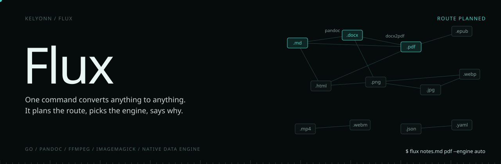
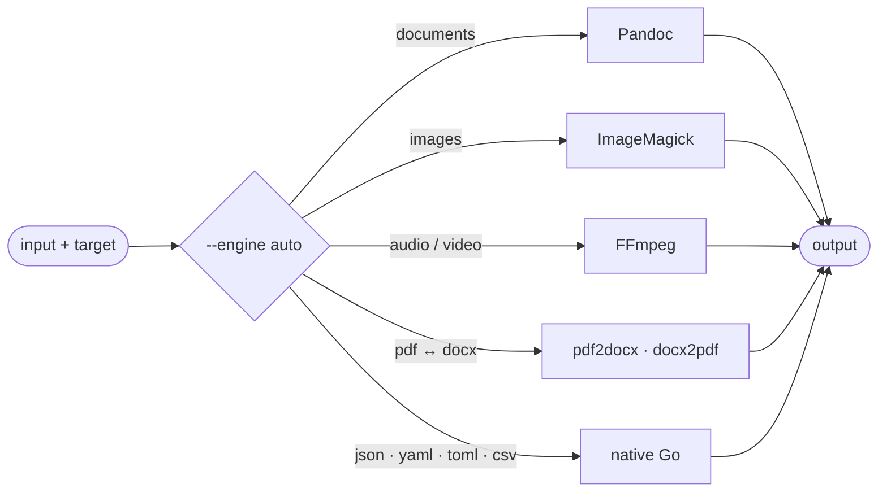

<p align="center">
  
</p>

<p align="center">
  <b>One command converts anything to anything. It plans the route, picks the engine, and tells you why.</b><br>
  <sub>A cross-platform conversion CLI and Go library that puts Pandoc, FFmpeg, ImageMagick, high-fidelity PDF and DOCX adapters, and a native data engine behind one predictable interface.</sub>
</p>

<p align="center">
  <sub>
    <a href="#overview">OVERVIEW</a> &nbsp;·&nbsp;
    <a href="#quick-start">QUICK START</a> &nbsp;·&nbsp;
    <a href="#the-engines">THE ENGINES</a> &nbsp;·&nbsp;
    <a href="#route-planning">ROUTE PLANNING</a> &nbsp;·&nbsp;
    <a href="#install">INSTALL</a> &nbsp;·&nbsp;
    <a href="#use-it">USE IT</a> &nbsp;·&nbsp;
    <a href="#as-a-library">AS A LIBRARY</a>
  </sub>
</p>

<br>

<table>
  <tr>
    <td><sub>LANGUAGE</sub><br><b>Go</b></td>
    <td><sub>PLATFORMS</sub><br><b>macOS · Linux · Windows</b></td>
    <td><sub>ENGINES</sub><br><b>5</b></td>
    <td><sub>PIPES</sub><br><b>stdin → stdout</b></td>
    <td><sub>ALSO</sub><br><b>Go SDK, <code>pkg/flux</code></b></td>
  </tr>
</table>

## Overview

Flux converts documents, images, audio, video and data through one predictable command. It does not reinvent conversion: it knows which proven tool should handle each job, plans the route, and tells you what it used.

> [!NOTE]
> Forcing an engine is strict: `--engine pandoc` means Pandoc, or an error that says what to install. Never a silent substitute.

## Quick start

```bash
go install github.com/kelyonn/flux@latest
flux notes.md pdf
flux doctor          # which engines are installed
```

## How a conversion is planned




## The engines

Flux does not reimplement conversion. It decides which proven tool should do it.

| Kind | Engine | Examples |
|---|---|---|
| Documents | Pandoc | `md → pdf`, `md → docx`, `html → epub` |
| Images | ImageMagick | `png → jpg`, `jpg → webp` |
| Audio and video | FFmpeg | `mov → mp4`, `mp4 → webm` |
| Structured data | native Go | `json ↔ yaml ↔ toml ↔ csv` |
| PDF and DOCX, high fidelity | Python adapters | `pdf2docx`, `docx2pdf` |

## Route planning

With `--engine auto` (the default) Flux plans a route from the source format to the target. It prefers a direct, high-fidelity conversion and only chains steps when it has to.

The rules are written down rather than implied:

- **Auto prefers fidelity.** `pdf → docx` goes through `pdf2docx`; `docx → pdf` prefers `docx2pdf` and falls back only if that runtime fails.
- **Forcing an engine is strict.** `--engine pandoc` means Pandoc or an error that says what to install. Never a silent substitute.
- **Fallbacks are explicit.** They are defined per route, not improvised, and a fallback on a complex PDF may cost layout fidelity.
- **`flux doctor` tells the truth** about which engines are installed and which versions.

```sh
flux convert -i report.docx -o report.pdf --engine auto      # plan it
flux convert -i notes.md -o notes.pdf --engine pandoc        # insist on it
```

## Install

**One command** installs the runtime engines, a Python environment for the adapters, the binary, and then checks itself:

```sh
make setup                                                           # macOS, Linux
powershell -ExecutionPolicy Bypass -File .\scripts\setup.ps1 -Yes    # Windows
```

Or just the binary, with Go:

```sh
go install github.com/kelyonn/flux@latest
```

Or in a container:

```sh
docker build -t flux .
docker run --rm flux convert -i input.json -o output.yaml
```

## Use it

```sh
flux input.jpg png                          # short form
flux docs/guide.md pdf
flux convert -i *.json -o yaml --force      # batch, with globs
flux convert -i sheet.csv -o sheet.json
cat data.json | flux convert -o - --from json --to yaml > out.yaml
```

| Command | Alias | |
|---|---|---|
| `flux convert` | `c` | convert files |
| `flux doctor` | `d` | engine availability and versions |
| `flux list-formats` | `lf` | what each engine supports |
| `flux info <file>` | `i` | inspect a file |

**Documents keep their structure.** Flux never invents sections. Style presets (`professional` by default, `developer` for markdown) and `--reference-doc` carry your own DOCX styling through a conversion.

## As a library

```go
import fluxlib "github.com/kelyonn/flux/pkg/flux"

if _, err := fluxlib.EnsureDependencies(ctx, true); err != nil {
    log.Fatal(err)
}
err := fluxlib.Convert("README.md", "README.html", fluxlib.ConvertOptions{
    Engine:      "auto",
    FormatStyle: "professional",
})
```

Full dependency and platform matrix: [REQUIREMENTS.md](REQUIREMENTS.md).

<sub>MIT.</sub>
